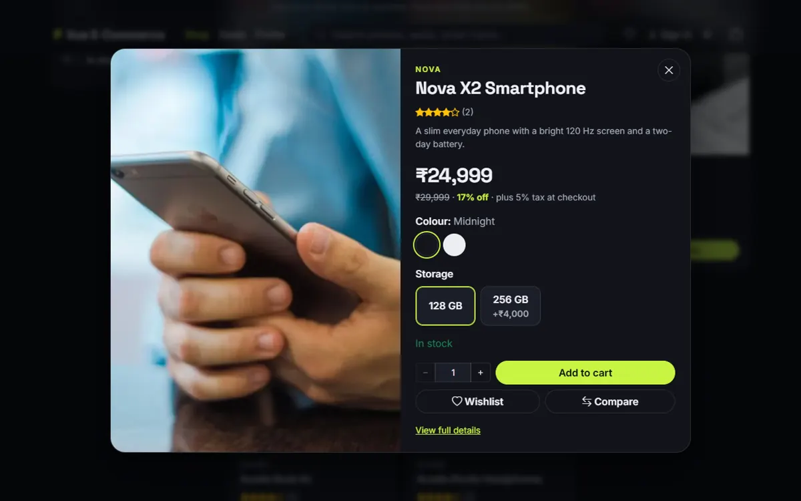
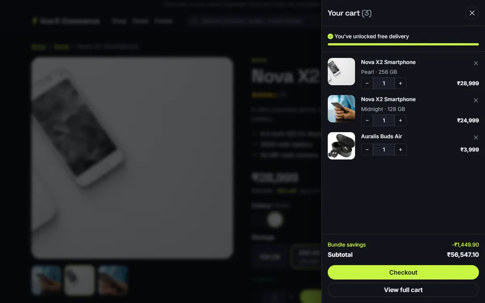
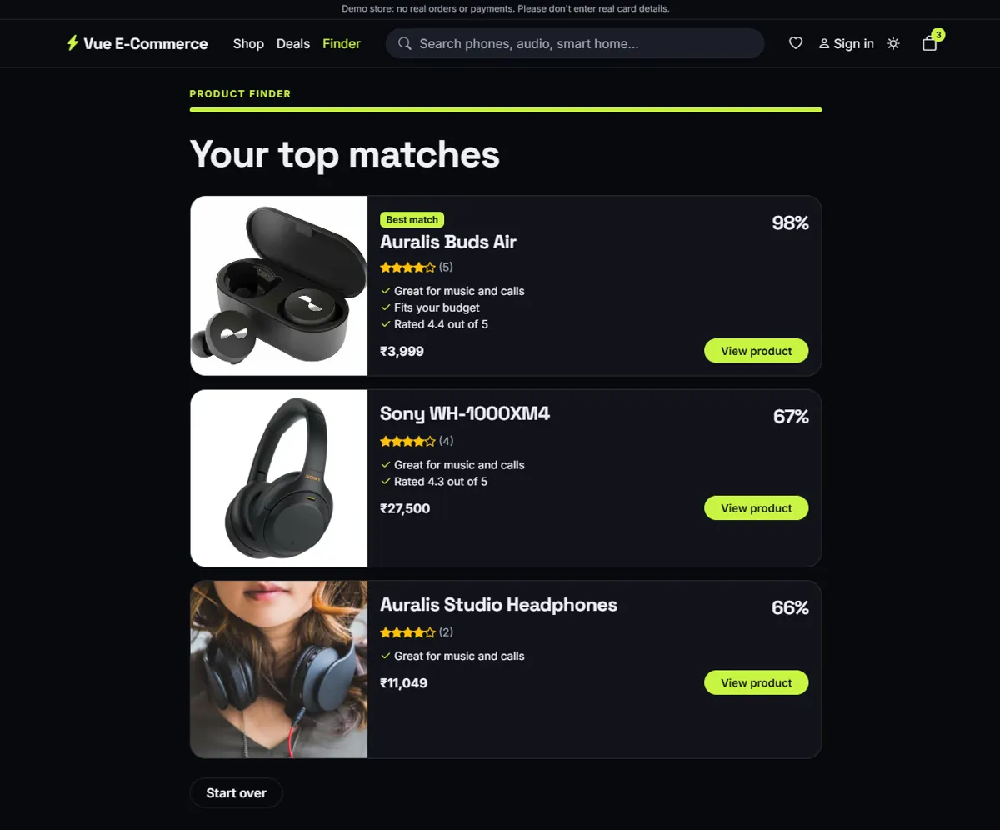
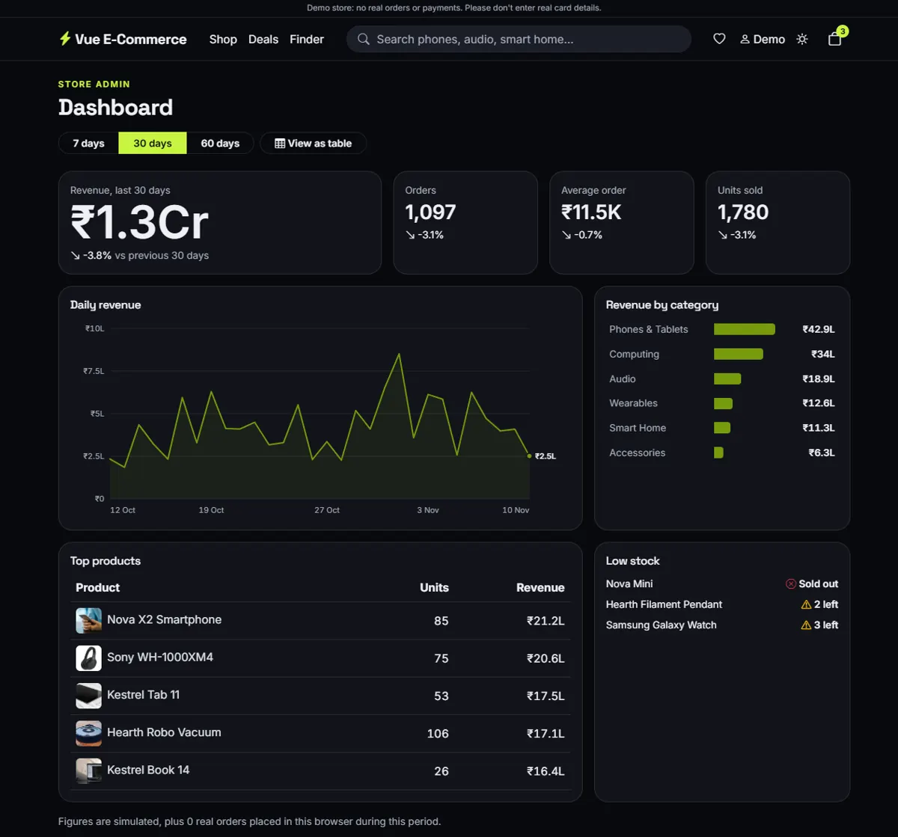

# Vue E-Commerce

A feature-complete electronics storefront built with Vue 3. It runs entirely in the browser, with a mock API standing in for a backend.

**[Live demo](https://nithinskumar866.github.io/ecommerce_vue/)**


> This is a demo store. No orders or payments are real. Please don't enter real card details or reuse a real password.

## Features

| Area | What's included |
| --- | --- |
| **Catalog** | 24 products, categories, instant search, shareable filters, sorting, pagination, quick view, image zoom |
| **Product options** | Colour and storage choices that change the price and image |
| **Cart** | Slide-out drawer, free-delivery meter, coupons, stock limits, syncing across browser tabs |
| **Deals** | Flash sales that rotate every six hours, bundles, comparison of up to four products |
| **Rewards** | Points on every order, Bronze, Silver and Gold tiers, redemption at checkout |
| **Checkout** | Address and delivery steps, card, UPI or Cash on Delivery, printable invoice |
| **Accounts** | Sign-up and sign-in, saved addresses, order history, tracking and cancellation |
| **Product finder** | A three-question quiz that recommends the best matches |
| **Admin dashboard** | Revenue chart, category breakdown, top products, low-stock alerts |
| **Experience** | Dark and light themes, page transitions, responsive layout, keyboard support, installable app that works offline |

## Screenshots

| Quick view | Cart drawer |
| --- | --- |
|  |  |

| Product finder | Admin dashboard |
| --- | --- |
|  |  |

## Try it

| What | How |
| --- | --- |
| Demo account | Press **Use demo account** on the sign-in page. It starts with 750 points and can open the dashboard. |
| Coupons | `WELCOME10`, `FLAT500`, `FREESHIP` |
| Successful payment | Card `4242 4242 4242 4242` |
| Declined payment | Card `4000 0000 0000 0002` |
| Bundle discount | Add a Nova X2 Smartphone and Auralis Buds Air to the cart |

## Tech stack

Vue 3, Vite, Pinia, Vue Router, Bootstrap 5, Vitest and ESLint.

## Run it locally

Requires Node 22.13 or newer.

```bash
git clone https://github.com/nithinskumar866/ecommerce_vue.git
cd ecommerce_vue
npm install
npm run dev
```

The app starts at http://localhost:8081.

| Command | Purpose |
| --- | --- |
| `npm run dev` | Start the development server |
| `npm run build` | Create a production build in `dist/` |
| `npm test` | Run the unit tests |
| `npm run lint` | Check the code |
| `npm run deploy` | Build and publish to GitHub Pages |

## Project structure

```text
src/
  api/          Mock backend; swap these functions for real API calls
  stores/       Pinia state: catalog, cart, auth, wishlist, compare, theme
  utils/        Pricing, variants, deals, loyalty, finder, filtering, validation
  components/   Reusable UI
  views/        One component per page
public/
  images/       Product photos and their credits
  sw.js         Offline support
tests/          Unit tests
```

## Image credits

Photos in `public/images/products` are CC0 or public domain, listed in [CREDITS.md](public/images/products/CREDITS.md). Third-party logos in those photos have been blurred. All product names and brands other than the fictional ones are the property of their owners and are used for demonstration only.
